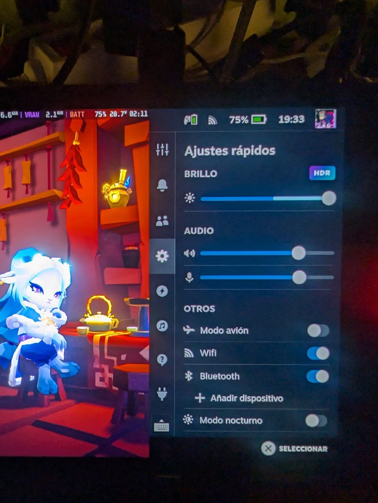

<div align="center">

# AutoHDR para Decky

**AutoHDR estilo Windows 11 para portátiles Linux: HDR10 real en juegos que solo emiten SDR.**

[](https://github.com/Pochowandpoch/decky-autohdr/actions/workflows/build.yml)
[](https://github.com/Pochowandpoch/decky-autohdr/releases/latest)
[](LICENSE)

[English](README.md) · Español



</div>

## Características

- **Salida HDR10 real.** El panel entra en modo HDR, igual que con un juego HDR nativo.
  No es un filtro de color.
- **Sin inyección de DLL.** A diferencia de ReShade, no se carga nada en la parte Windows del juego.
- **Perfil global o por juego**, que se aplica automáticamente al abrir cada juego.
- **Ajustes en vivo**: blanco de papel, pico de brillo, gama Vivid, brillo, contraste, saturación,
  temperatura de color y gamma.
- **Diagnóstico** que lee el estado real del panel desde el kernel.
- **10 idiomas**: Español, English, Français, Deutsch, Italiano, Português, Català, 中文, 日本語, Русский.
  El modo automático usa el idioma de Steam.

## Requisitos

- [Decky Loader](https://decky.xyz/) en el modo juego (SteamOS, Bazzite, Anatase o cualquier sesión de gamescope).
- Una **pantalla HDR**: una portátil OLED con HDR, o una TV o monitor HDR externo.
- Juegos que dibujen con **Vulkan**. Con Proton son casi todos los juegos DirectX (vía DXVK o vkd3d-proton).
  Los juegos OpenGL nativos no son compatibles.

Probado en Anatase OS con una OneXPlayer X2 Mini Pro (panel OLED HDR de Samsung).
Se agradecen mucho los informes de otros dispositivos.

## Instalación

1. Descarga `decky-autohdr-vX.Y.Z.zip` de la [última release](https://github.com/Pochowandpoch/decky-autohdr/releases/latest).
2. En el modo juego: **Decky → ⚙ Ajustes → General** y activa el **Modo desarrollador**.
3. **Decky → ⚙ Ajustes → Developer → Install Plugin from ZIP File** y elige el ZIP.
4. Abre el menú de acceso rápido (`…`), entra en el icono **HDR** y activa **AutoHDR**.
5. **Abre (o reinicia) el juego.** El panel pasará a HDR10 por sí solo.

> Activar o desactivar AutoHDR requiere reiniciar el juego. Todos los sliders se aplican en vivo.

## Cómo funciona

```
Juego (D3D) ─► DXVK / vkd3d-proton ─► Vulkan ─► VK_LAYER_AUTOHDR ─► gamescope ─► panel HDR10
                                                 │
                                                 └ imagen SDR ─► compute shader ─► HDR10 (PQ / BT.2020)
```

1. El plugin registra una **capa Vulkan** nativa de Linux. Como MangoHud, se carga por debajo
   de Wine/Proton, en la parte Linux del proceso del juego.
2. Cuando el juego crea su swapchain SDR, la capa pide a gamescope uno **HDR10**
   (`A2B10G10R10` + `HDR10_ST2084`) y le da al juego imágenes intermedias en el formato que espera.
3. En cada fotograma, un compute shader convierte la imagen. Es un port de la matemática de
   [`AutoHDR.fx`](THIRD_PARTY_NOTICES.md) (ReShade): balance de blancos, brillo/contraste Bezier,
   saturación, tonemap inverso Reinhard, BT.709 → BT.2020 y codificación PQ.
4. gamescope recibe contenido HDR y pone el panel en HDR10. Este paso es imprescindible en sistemas
   cuyo gamescope solo activa HDR con contenido HDR (por ejemplo, Anatase).

## Ajustes

| Ajuste | Qué hace | Por defecto |
|---|---|---|
| Blanco de papel (nits) | Brillo general de la imagen | 200 |
| Pico de brillo (nits) | Hasta dónde se expanden las luces. Pon el pico de tu pantalla | 1000 |
| Gama ampliada (Vivid) | Colores más saturados (matriz 709 → 2020 ampliada de Microsoft) | Sí |
| Ajustes de color | Brillo, contraste, saturación, temperatura, gamma | No |

Opciones de lanzamiento por juego (Steam → juego → Propiedades → Opciones de lanzamiento):

| Opción | Efecto |
|---|---|
| `DISABLE_AUTOHDR=1 %command%` | La capa no se carga en ese juego |
| `AUTOHDR=0 %command%` | Nunca aplicar AutoHDR a ese juego |
| `AUTOHDR=1 %command%` | Aplicar siempre AutoHDR a ese juego |

## Anticheat

ReShade activa los anticheat porque inyecta `dxgi.dll` en el juego de Windows.
Esta capa es una librería de Linux que nunca entra en la parte Windows del juego. Es el mismo
tipo de componente que MangoHud o la capa WSI del propio gamescope. El riesgo es muy bajo,
pero **nadie puede garantizarlo para todos los anticheat**. Si quieres ir con cuidado, prueba
los juegos online primero con una cuenta secundaria, o exclúyelos con `DISABLE_AUTOHDR=1 %command%`.

## Solución de problemas

| Problema | Qué revisar |
|---|---|
| El panel sigue en SDR | Reinicia el juego después de activar AutoHDR y pulsa **Diagnóstico**. |
| "gamescope no ofreció formatos HDR10" | El HDR está desactivado en gamescope o tu pantalla no se detecta como HDR. |
| Pantalla negra, colores raros o cierre al abrir | Añade `DISABLE_AUTOHDR=1 %command%` a ese juego y [abre una incidencia](https://github.com/Pochowandpoch/decky-autohdr/issues/new/choose). |
| El plugin se queda en "Cargando…" | Reinicia Decky o la consola. |

Registros:
- plugin: `~/homebrew/logs/autohdr-gamescope/`
- capa: `~/.config/autohdr/layer.log`

## Desinstalar

Desinstala el plugin desde Decky. El registro de la capa
(`~/.local/share/vulkan/implicit_layer.d/autohdr_layer_*.json`) se elimina automáticamente.

## Compilar desde el código

```bash
# Frontend
pnpm install
pnpm run build

# Capa Vulkan (necesita glslang, las cabeceras de Vulkan y zig o gcc)
ZIG=/ruta/a/zig VULKAN_HEADERS=/ruta/a/Vulkan-Headers/include sh layer/build.sh
```

Al subir una etiqueta `vX.Y.Z`, GitHub Actions compila todo y publica el ZIP en la release
([workflow](.github/workflows/build.yml)).

## Colaborar

Se agradecen los informes de errores, las pruebas en otros dispositivos y las correcciones de traducción.
Las traducciones están en [`src/i18n.ts`](src/i18n.ts).

## Créditos

- **MajorPainTheCactus**: autor del shader HCRT `AutoHDR.fx`, cuya matemática porta este proyecto (MIT).
- **Microsoft Xbox ATG**: código de ejemplo HDR que usa ese shader (MIT).
- El equipo de **Decky Loader**.

Ver [THIRD_PARTY_NOTICES.md](THIRD_PARTY_NOTICES.md).

## Licencia

[MIT](LICENSE) © 2026 Pochowandpoch
