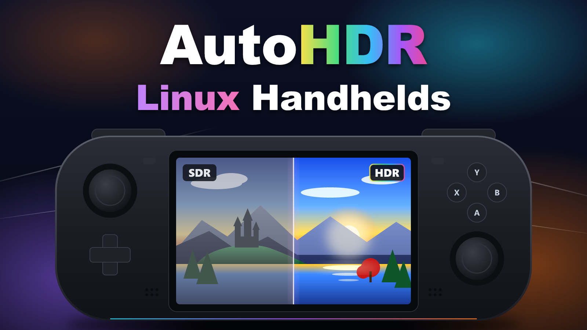
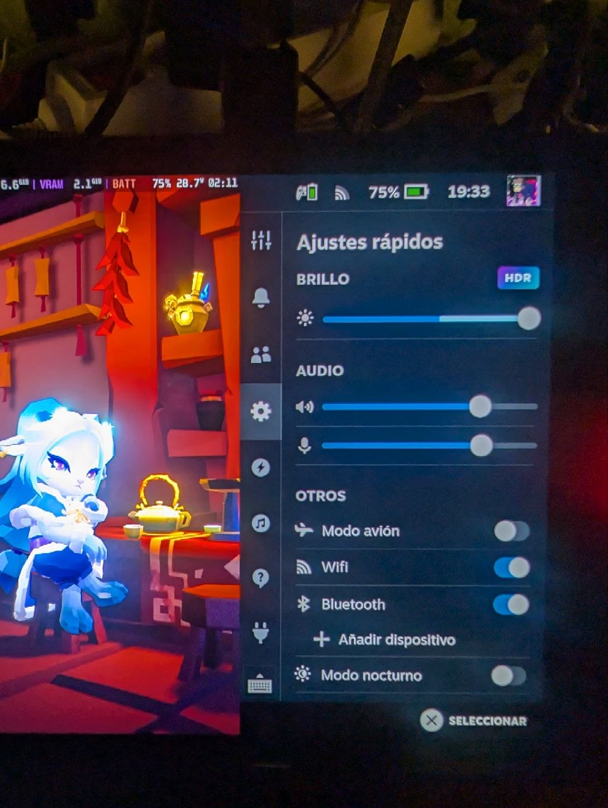

<div align="center">



# AutoHDR for Decky

**Windows-11-style AutoHDR for Linux handhelds: real HDR10 in games that only output SDR.**

[](https://github.com/Pochowan/decky-autohdr/actions/workflows/build.yml)
[](https://github.com/Pochowan/decky-autohdr/releases/latest)
[](LICENSE)

English · [Español](README.es.md)

</div>

## Features

- **Real HDR10 output.** The panel switches into HDR mode, just like with a native HDR game.
  This is not a color filter.
- **No DLL injection.** Unlike ReShade, nothing is loaded into the Windows side of the game.
- **Global or per-game profiles**, applied automatically when a game starts.
- **Live controls**: paper white, peak brightness, Vivid gamut, brightness, contrast, saturation,
  color temperature and gamma.
- **Diagnostics** that read the real panel state from the kernel.
- **10 languages**: Español, English, Français, Deutsch, Italiano, Português, Català,
  中文, 日本語, Русский. Automatic mode follows Steam's language.

## Screenshot



*An SDR game (Gunfire Reborn) running with AutoHDR. Steam's Quick Settings show the **HDR** badge
because the panel is really in HDR10 mode.*

## Requirements

- [Decky Loader](https://decky.xyz/) in Gaming Mode (SteamOS, Bazzite, Anatase or any gamescope session).
- An **HDR display**: an OLED handheld with HDR, or an external HDR TV or monitor.
- Games that render through **Vulkan**. Under Proton that's almost every DirectX game
  (via DXVK or vkd3d-proton). Native OpenGL games are not supported.

Tested on Anatase OS with a OneXPlayer X2 Mini Pro (Samsung OLED HDR panel).
Reports from other devices are very welcome.

## Installation

1. Download `decky-autohdr-vX.Y.Z.zip` from the [latest release](https://github.com/Pochowan/decky-autohdr/releases/latest).
2. In Gaming Mode: **Decky → ⚙ Settings → General**, then enable **Developer mode**.
3. **Decky → ⚙ Settings → Developer → Install Plugin from ZIP File**, and pick the ZIP.
4. Open the Quick Access Menu (`…`), select the **HDR** icon and enable **AutoHDR**.
5. **Launch (or restart) the game.** The panel switches to HDR10 on its own.

> Turning AutoHDR on or off needs a game restart. All sliders apply live.

## How it works

```
Game (D3D) ─► DXVK / vkd3d-proton ─► Vulkan ─► VK_LAYER_AUTOHDR ─► gamescope ─► HDR10 panel
                                                │
                                                └ SDR image ─► compute shader ─► HDR10 (PQ / BT.2020)
```

1. The plugin registers a native Linux **Vulkan layer**. Like MangoHud, it loads below Wine/Proton,
   in the Linux part of the game process.
2. When the game creates its SDR swapchain, the layer requests an **HDR10** one from gamescope
   (`A2B10G10R10` + `HDR10_ST2084`) and gives the game intermediate images in the format it expects.
3. Every frame, a compute shader converts the image. It's a port of the
   [`AutoHDR.fx`](THIRD_PARTY_NOTICES.md) ReShade math: white balance, Bezier brightness/contrast,
   saturation, inverse Reinhard tonemap, BT.709 → BT.2020 and PQ encoding.
4. gamescope now receives HDR content and puts the panel in HDR10. This step is required on
   systems whose gamescope only enables HDR for HDR content (for example Anatase).

## Settings

| Setting | What it does | Default |
|---|---|---|
| Paper white (nits) | Overall image brightness | 200 |
| Peak brightness (nits) | How far highlights are expanded. Set it to your display's peak | 1000 |
| Expanded gamut (Vivid) | More saturated colors (Microsoft's expanded 709 → 2020 matrix) | On |
| Color adjustments | Brightness, contrast, saturation, temperature, gamma | Off |

Optional launch options per game (Steam → game → Properties → Launch options):

| Launch option | Effect |
|---|---|
| `DISABLE_AUTOHDR=1 %command%` | The layer is not loaded at all in that game |
| `AUTOHDR=0 %command%` | Never apply AutoHDR to that game |
| `AUTOHDR=1 %command%` | Always apply AutoHDR to that game |

## Anti-cheat

ReShade triggers anti-cheat because it injects `dxgi.dll` into the Windows game.
This layer is a Linux library that never enters the Windows side of the game. It's the
same kind of component as MangoHud or gamescope's own WSI layer. The risk is very low,
but **nobody can guarantee it for every anti-cheat**. If you're cautious, test online games
on a secondary account first, or exclude them with `DISABLE_AUTOHDR=1 %command%`.

## Troubleshooting

| Problem | What to check |
|---|---|
| Panel stays in SDR | Restart the game after enabling AutoHDR. Then press **Diagnostics**. |
| "gamescope offered no HDR10 formats" | HDR is disabled in gamescope, or your display isn't detected as HDR. |
| Black screen, wrong colors or crash at launch | Add `DISABLE_AUTOHDR=1 %command%` for that game and [open an issue](https://github.com/Pochowan/decky-autohdr/issues/new/choose). |
| Plugin stuck on "Loading…" | Restart Decky or the console. |

Logs:
- plugin: `~/homebrew/logs/autohdr-gamescope/`
- layer: `~/.config/autohdr/layer.log`

## Uninstalling

Uninstall the plugin from Decky. Its layer registration
(`~/.local/share/vulkan/implicit_layer.d/autohdr_layer_*.json`) is removed automatically.

## Building from source

```bash
# Frontend
pnpm install
pnpm run build

# Vulkan layer (needs glslang, Vulkan headers and zig or gcc)
ZIG=/path/to/zig VULKAN_HEADERS=/path/to/Vulkan-Headers/include sh layer/build.sh
```

Pushing a `vX.Y.Z` tag makes GitHub Actions build everything and publish the release ZIP
([workflow](.github/workflows/build.yml)).

| Path | Contents |
|---|---|
| `src/` | Decky frontend (React/TypeScript), translations in `src/i18n.ts` |
| `main.py`, `py_modules/` | Python backend: profiles, layer registration, diagnostics |
| `layer/` | Vulkan layer (C) and SDR→HDR compute shader (GLSL) |

## Contributing

Bug reports, device test results and translation fixes are very welcome.
Translations live in [`src/i18n.ts`](src/i18n.ts).

## Credits

- **MajorPainTheCactus**: author of the HCRT `AutoHDR.fx` shader whose math this project ports (MIT).
- **Microsoft Xbox ATG**: HDR sample code used by that shader (MIT).
- The **Decky Loader** team.

See [THIRD_PARTY_NOTICES.md](THIRD_PARTY_NOTICES.md).

## License

[MIT](LICENSE) © 2026 Pochowan
